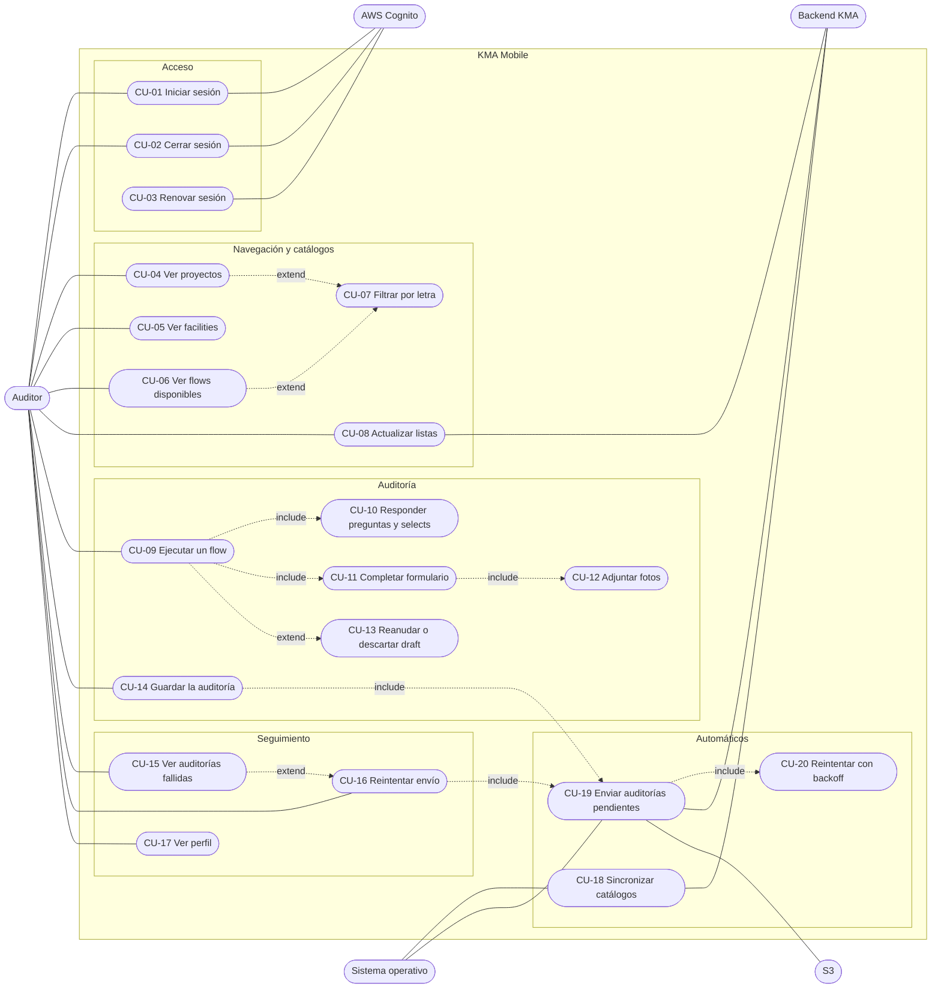

# Casos de uso — KMA Mobile

Qué puede hacer cada actor con la app. Los flujos detallados están en [secuencias/](./secuencias/README.md) y los
estados en [DTE.md](./DTE.md).

## 1. Actores

| Actor | Tipo | Rol |
|---|---|---|
| **Auditor** | primario | Persona en campo que usa la app |
| **Backend KMA** | secundario | API de catálogos, presign de fotos y creación de auditorías |
| **AWS Cognito** | secundario | Autenticación y renovación de sesión |
| **S3** | secundario | Recibe las fotos por URL presignada |
| **Sistema operativo** | secundario | Entrega eventos de red, foreground y tarea de background |

## 2. Diagrama general

Notación: línea continua = el actor participa; punteada `include` = el caso siempre usa al otro; `extend` = el caso
opcional amplía al principal.

## 3. Descripción de los casos de uso

### Acceso

| Caso | Actor | Precondición | Flujo principal | Sin red |
|---|---|---|---|---|
| **CU-01 Iniciar sesión** | Auditor, Cognito | Sin sesión | Ingresa usuario y contraseña, Cognito devuelve tokens, se guardan de forma segura y se entra a Projects | Requiere red. Con sesión ya guardada, la app abre sin pedir login |
| **CU-02 Cerrar sesión** | Auditor, Cognito | Con sesión | Si hay auditorías pendientes avisa que se enviarán en el próximo login, revoca la sesión en Cognito y limpia los tokens | Funciona: la revocación remota es best-effort; los datos locales se conservan |
| **CU-03 Renovar sesión** | Sistema, Cognito | IdToken vencido | Ante una request, renueva con el refresh token (una sola vez aunque haya varias requests) | Si falla por red no cierra sesión; si Cognito rechaza el refresh token, cierra sesión y avisa "Session expired" |

### Navegación y catálogos

| Caso | Actor | Descripción | Sin red |
|---|---|---|---|
| **CU-04 Ver proyectos** | Auditor | Lista los proyectos del usuario; elegir uno lleva a sus facilities | Muestra los proyectos sincronizados |
| **CU-05 Ver facilities** | Auditor | Lista las facilities del proyecto; elegir una lleva al selector de flows | Muestra lo cacheado |
| **CU-06 Ver flows disponibles** | Auditor | Lista los flows con su tarjeta; elegir uno lo ejecuta | Muestra el catálogo y las imágenes cacheadas |
| **CU-07 Filtrar por letra** | Auditor | Filtra proyectos y flows por la inicial del nombre | Igual |
| **CU-08 Actualizar listas** | Auditor | *Pull-to-refresh* para volver a pedir los datos | Sin efecto: se mantienen los datos locales |

### Auditoría

| Caso | Actor | Descripción | Sin red |
|---|---|---|---|
| **CU-09 Ejecutar un flow** | Auditor | Recorre los pasos del flow; la navegación depende de las respuestas (sí/no, condicionales, opciones). Cada paso guarda el draft | Funciona completo |
| **CU-10 Responder preguntas y selects** | Auditor | Responde *Yes / No / Unsure* o elige una opción; al cambiar una respuesta anterior se descartan las ramas posteriores | Funciona |
| **CU-11 Completar formulario** | Auditor | Llena los campos de texto, número y foto de un paso `Form` | Funciona |
| **CU-12 Adjuntar fotos** | Auditor | Toma una foto con la cámara o la elige de la galería; se convierte a JPEG si es HEIC y se guarda en el dispositivo. Puede quitarla | Funciona |
| **CU-13 Reanudar o descartar draft** | Auditor | Al abrir un flow con un draft propio ofrece *Resume draft* o *Start over*. Si el flow cambió de versión, se descarta con aviso | Funciona |
| **CU-14 Guardar la auditoría** | Auditor | En el último paso, *Save audit* guarda y encola; el auditor vuelve al selector y el envío sigue solo | Funciona: queda encolada hasta tener red |

### Seguimiento

| Caso | Actor | Descripción |
|---|---|---|
| **CU-15 Ver auditorías fallidas** | Auditor | Banner en el selector y sección en Profile: "N audits could not be synced", con el mensaje del backend. Solo se muestra si hay fallidas |
| **CU-16 Reintentar envío** | Auditor | *Retry* (una) o *Retry all* vuelve a encolar con intentos en cero y dispara el envío |
| **CU-17 Ver perfil** | Auditor | Muestra datos y rol del usuario, las auditorías fallidas y el botón de cierre de sesión |

### Automáticos (sin intervención del auditor)

| Caso | Disparador | Descripción |
|---|---|---|
| **CU-18 Sincronizar catálogos** | Arranque, foreground, red recuperada, login/refresh | Actualiza proyectos, flows (con imágenes) y facilities en SQLite. Cooldown de 60 s |
| **CU-19 Enviar auditorías pendientes** | Al guardar, foreground, red recuperada, login/refresh, tarea de background | Pide presign, sube las fotos a S3, crea la auditoría en el backend y limpia lo local |
| **CU-20 Reintentar con backoff** | Fallo recuperable del envío | Reagenda con backoff exponencial (60 s a 30 min). A los 15 intentos o ante un 4xx no recuperable, la auditoría queda *failed* |

## 4. Reglas transversales

- Una auditoría **nunca se borra por un error**: se reintenta o queda fallida y visible.
- Cada usuario ve y envía **solo sus** auditorías pendientes, aunque otro use el mismo dispositivo.
- Las pantallas leen siempre del almacenamiento local; la red solo lo mantiene actualizado.
- Toda la interfaz está en inglés.
