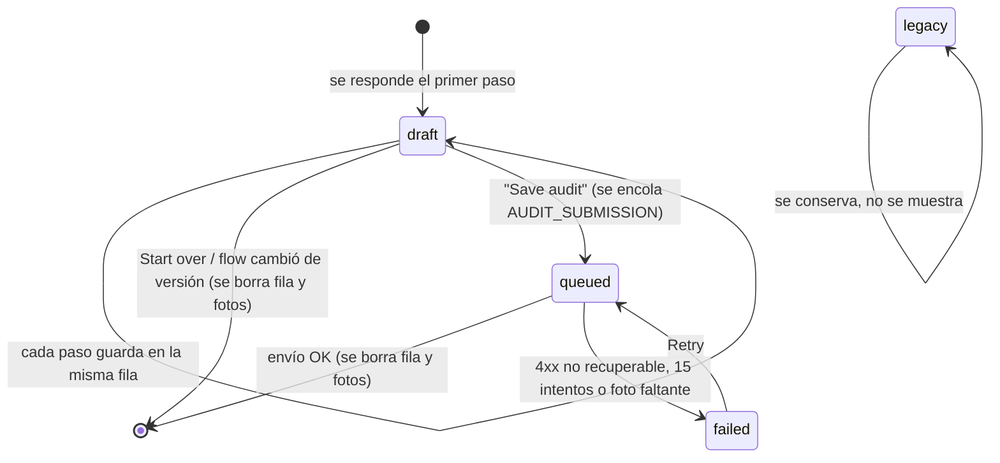
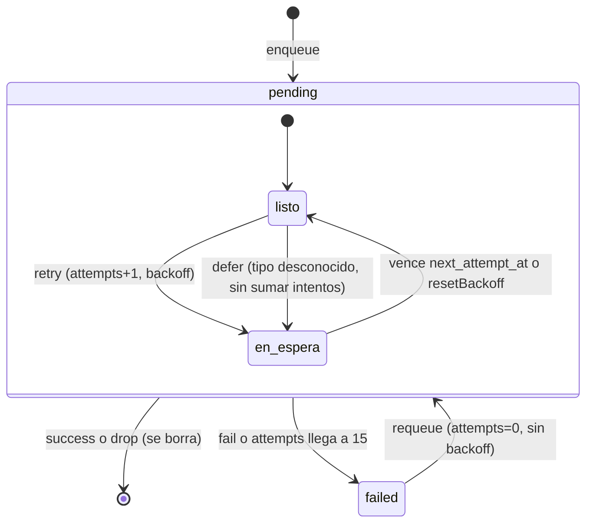
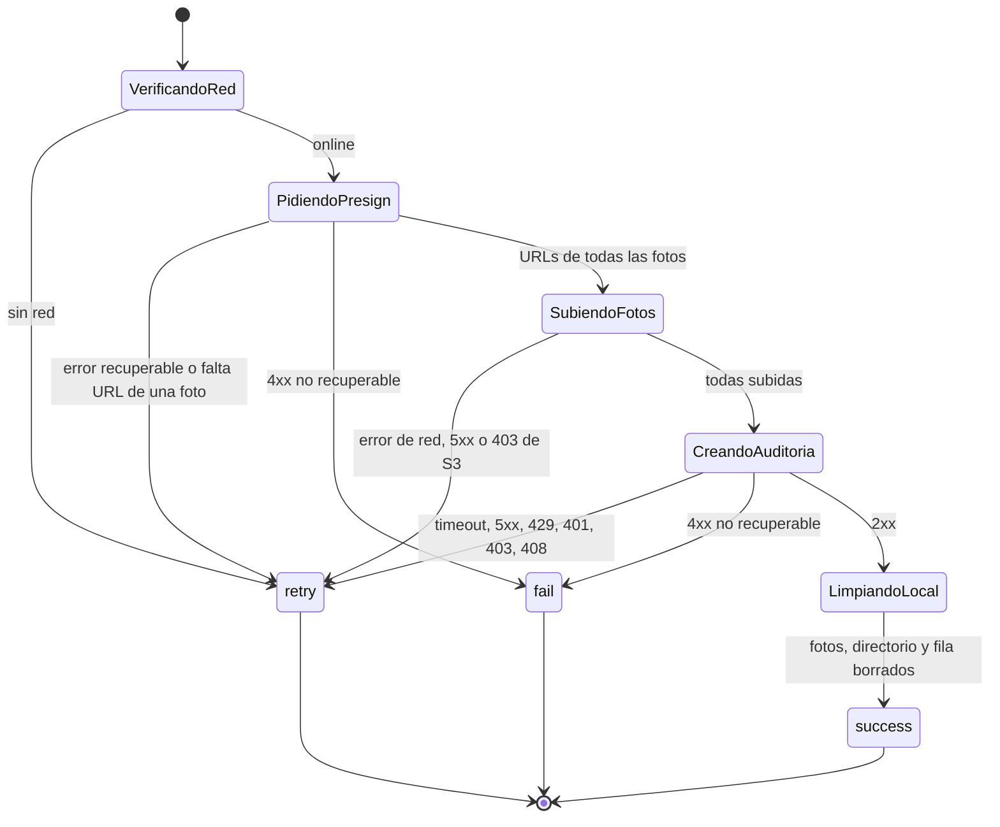
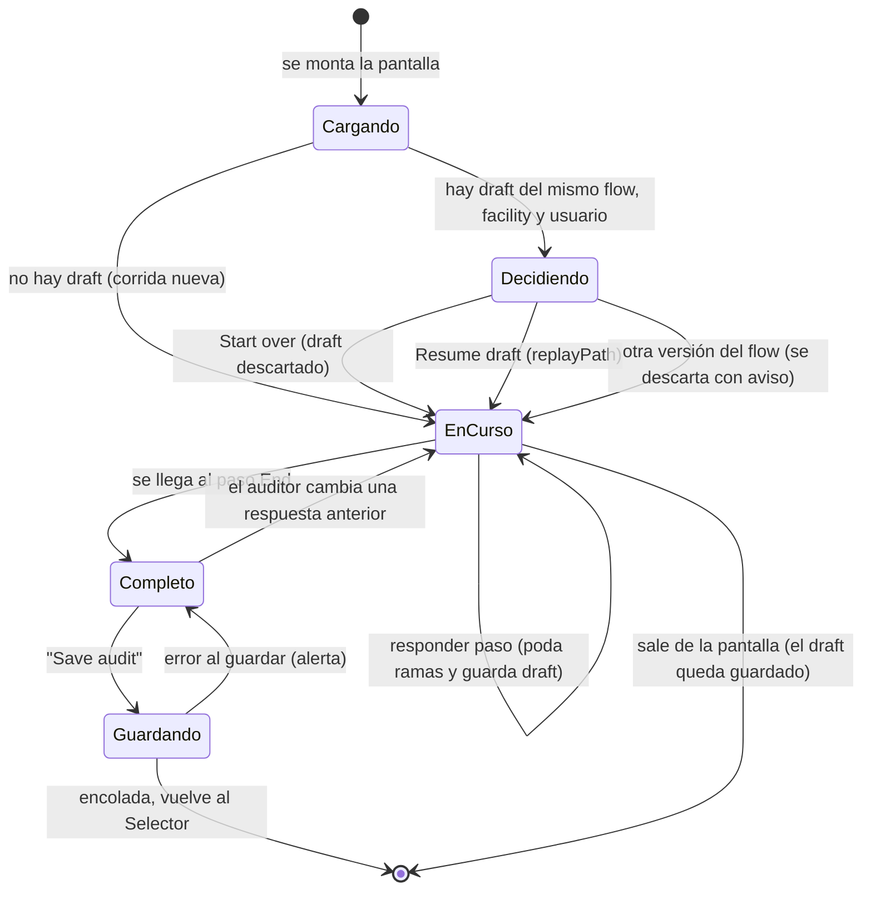
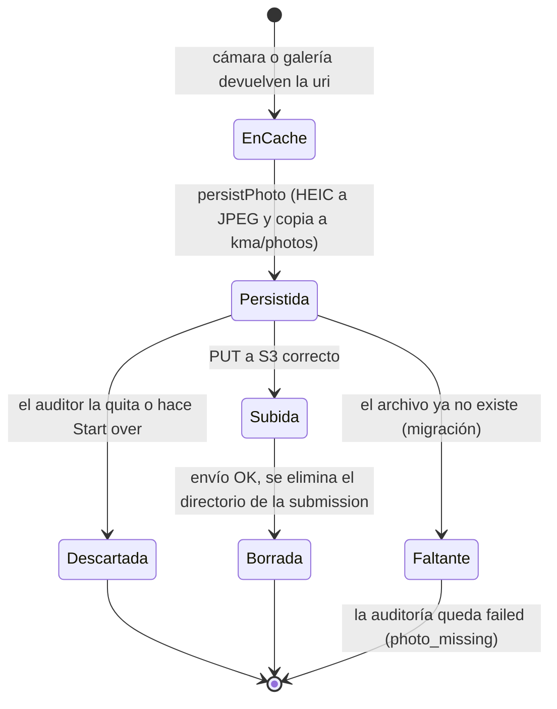
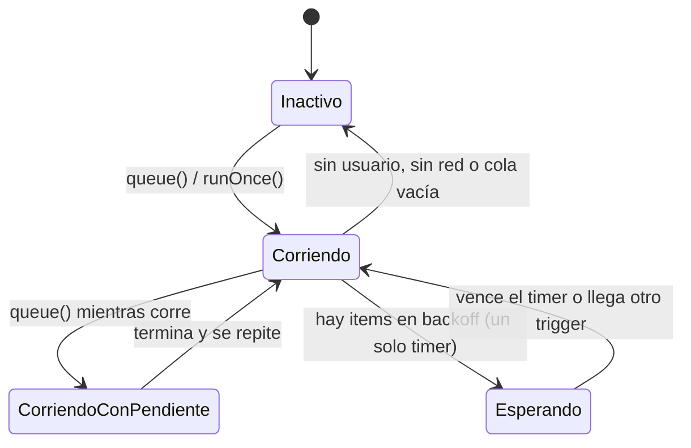
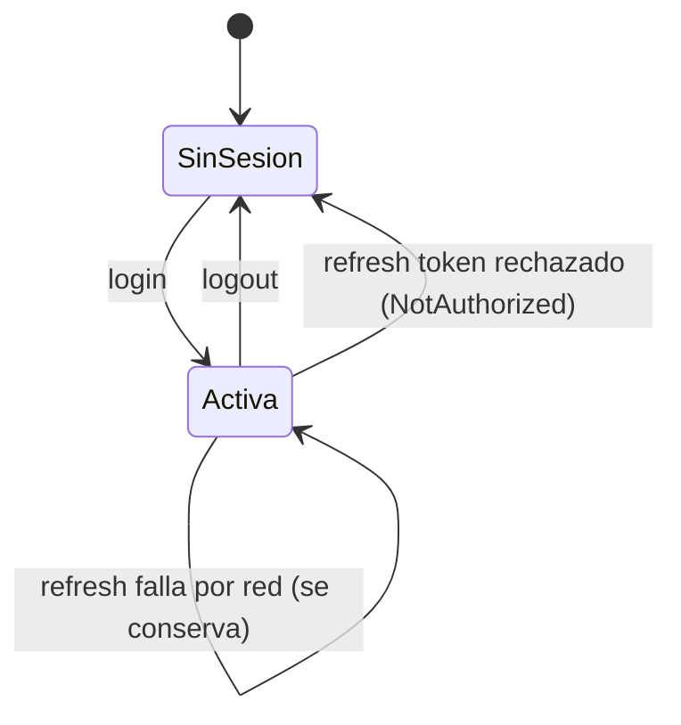
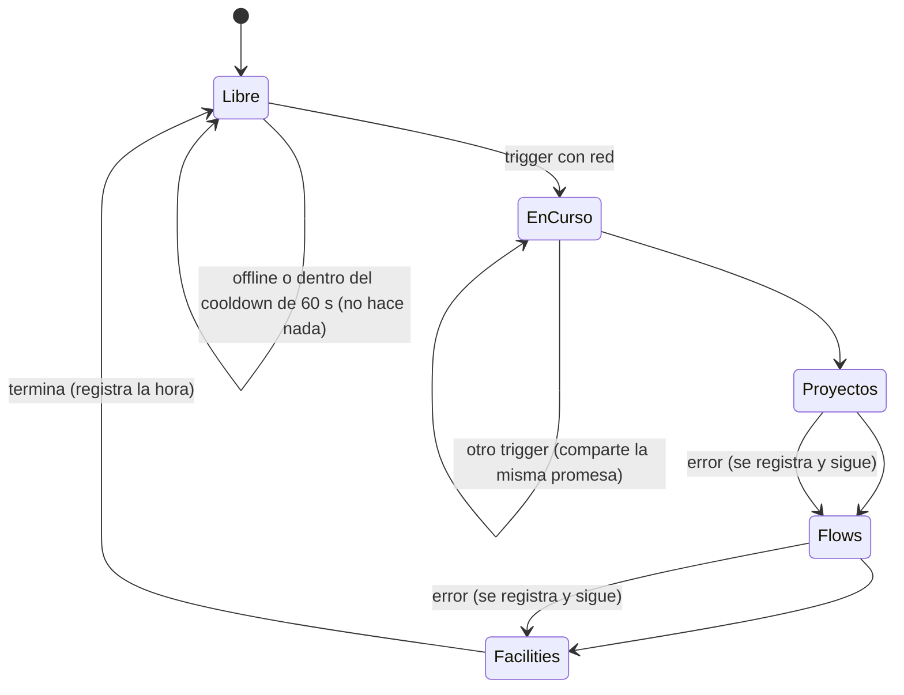

# DTE — Diagramas de transición de estados

Estados y transiciones de las entidades con ciclo de vida en KMA Mobile. Contexto en
[ARQUITECTURA.md](./ARQUITECTURA.md); el modelo de datos en [UML.md](./UML.md).

Índice: 1. [Submission](#1-submission-auditoría-local) · 2. [Item de outbox](#2-item-de-outbox) ·
3. [Envío de una auditoría](#3-envío-de-una-auditoría) · 4. [Corrida del flow runner](#4-corrida-del-flow-runner) ·
5. [Foto](#5-foto) · 6. [SyncService](#6-syncservice) · 7. [Sesión](#7-sesión) ·
8. [Sincronización de catálogos](#8-sincronización-de-catálogos)

---

## 1. Submission (auditoría local)

Columna `submissions.status`.

| Estado | Significado | Visible para el auditor |
|---|---|---|
| `draft` | auditoría en curso | se ofrece reanudarla al abrir el mismo flow/facility |
| `queued` | terminada, con item pendiente en el outbox | sí (como pendiente) |
| `failed` | el envío falló sin remedio automático | banner en Selector y sección en Profile, con *Retry* |
| `legacy` | filas anteriores al control de estados, sin item en outbox | no |

## 2. Item de outbox

Columna `outbox.status` más `attempts` y `next_attempt_at`.

`listo` = `pending` con `next_attempt_at` nulo o vencido: es el único subestado que entra en el lote.

## 3. Envío de una auditoría

Etapas internas de `submitAuditOnlineFromSnapshot` y su resultado hacia el `SyncService`.

`retry`, `fail` y `success` son los resultados que consume el dispatcher (ver diagrama 2).

## 4. Corrida del flow runner

Ciclo de una auditoría desde que se abre el flow hasta que se guarda.

Los pasos visibles son una lista que crece al avanzar y se recorta al cambiar una respuesta anterior.

## 5. Foto

Archivo local de una foto de la auditoría.

En SQLite la foto es solo una uri dentro de las respuestas del `Form`; el estado lo determina dónde está el archivo.

## 6. SyncService

Dentro de `Corriendo` se drenan lotes hasta vaciar lo que está listo (máximo 50 lotes por corrida).

## 7. Sesión

Al volver a `SinSesion` el `AuthGuard` redirige al login. Los datos locales no se borran.

## 8. Sincronización de catálogos

