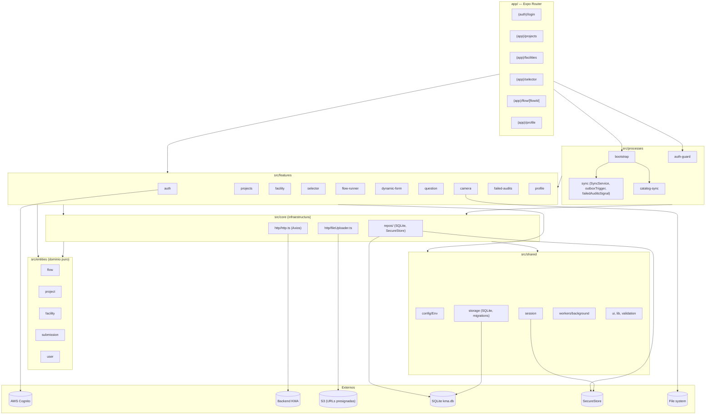
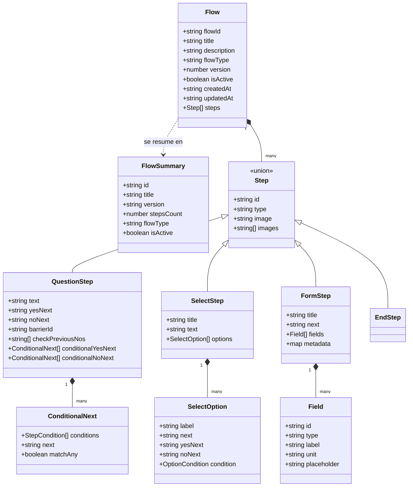
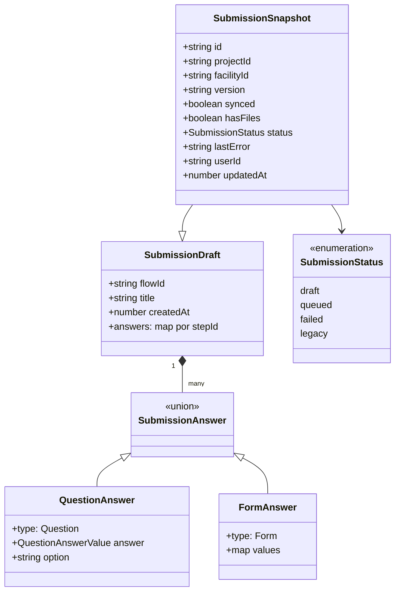
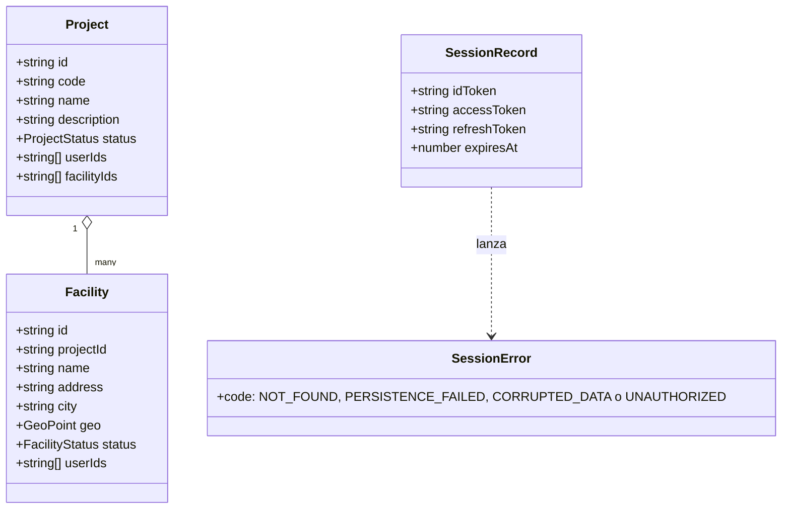
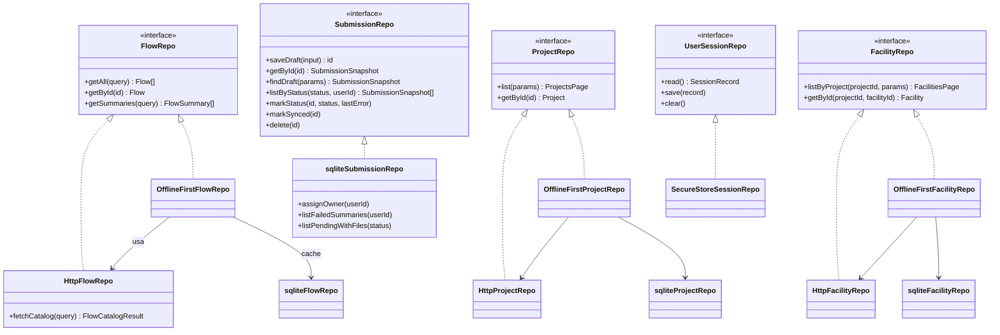
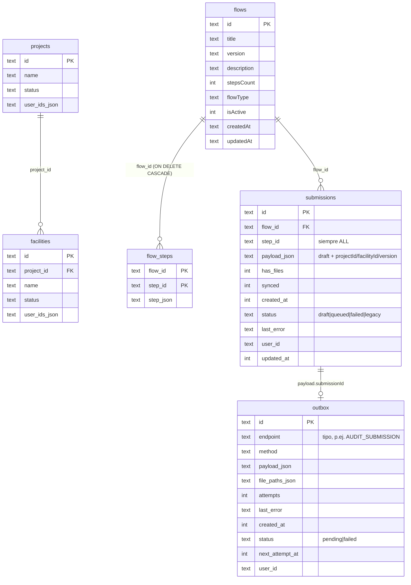
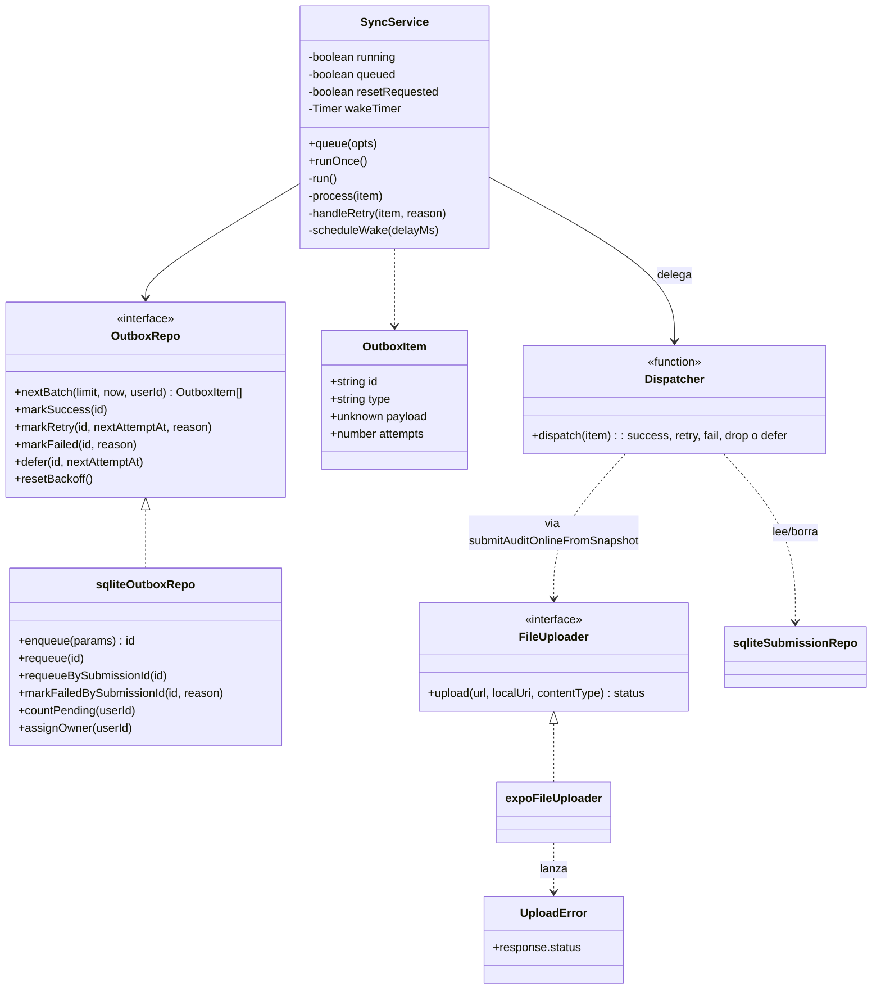
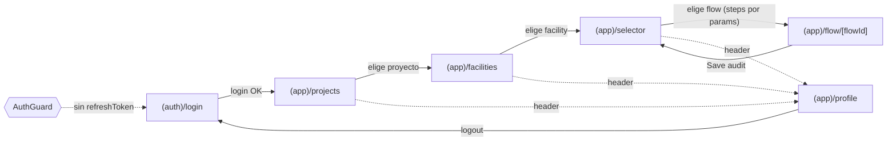

# UML — KMA Mobile

Diagramas en [Mermaid](https://mermaid.js.org/) (se renderizan en GitHub y en la mayoría de los editores de
Markdown). Contexto en [ARQUITECTURA.md](./ARQUITECTURA.md); flujos paso a paso en
[secuencias/](./secuencias/README.md).

Índice: 1. [Componentes y capas](#1-componentes-y-capas) · 2. [Dominio](#2-clases-de-dominio) ·
3. [Puertos y adaptadores](#3-puertos-y-adaptadores) · 4. [Modelo de datos](#4-modelo-de-datos-sqlite) ·
5. [Estados](./DTE.md) · 6. [Sync y outbox](#6-clases-de-sincronización) ·
7. [Navegación](#7-navegación-de-pantallas)

---

## 1. Componentes y capas

Regla de lectura: una flecha significa "depende de". `entities` no depende de nadie (ni de React Native ni de
axios); `core` y `shared` son accesibles desde cualquier capa.

---

## 2. Clases de dominio

### 2.1 Flows y steps

`Field.type` ∈ `text | number | photo | button`. `Step.type` ∈ `Question | Select | Form | End`.

### 2.2 Submissions (auditoría local)

Las fotos viven dentro de `FormAnswer.values.photos` (array de URIs `file://` locales; tras el envío se
reemplazan por las `file_url` de S3 en el payload que va a la API, no en SQLite).

### 2.3 Catálogo y sesión

---

## 3. Puertos y adaptadores

Los `OfflineFirst*Repo` implementan el mismo puerto que los `Http*Repo`: los casos de uso y la UI no distinguen el origen
de los datos.

---

## 4. Modelo de datos (SQLite)

Notas:

- `submissions` y `outbox` no tienen FK entre sí: el vínculo es lógico (`payload_json → submissionId`).
- Índices relevantes: `idx_outbox_ready(status, next_attempt_at, created_at)` para el lote, y
  `idx_submissions_status(status, flow_id)` para buscar drafts.
- Migraciones: 1 (esquema base) · 2 (proyectos y facilities) · 3 (metadatos de flows) · 4 (estados de
  submissions/outbox, `user_id`, backoff).
- Fuera de SQLite: tokens en SecureStore y fotos en `documentDirectory/kma/photos/<submissionId>/`.

---

## 5. Diagramas de estados

Los diagramas de transición de estados (submission, outbox, envío, corrida del flow, foto, `SyncService`,
sesión y catálogos) están en [DTE.md](./DTE.md).

---

## 6. Clases de sincronización

Constantes: `OUTBOX_BACKOFF_BASE_MS = 60 s`, `OUTBOX_BACKOFF_MAX_MS = 30 min`, `OUTBOX_MAX_ATTEMPTS = 15`.

---

## 7. Navegación de pantallas

El `AuthGuard` envuelve todo `(app)`. El Selector muestra el banner de auditorías fallidas y el Profile su
sección con el botón *Retry*.
