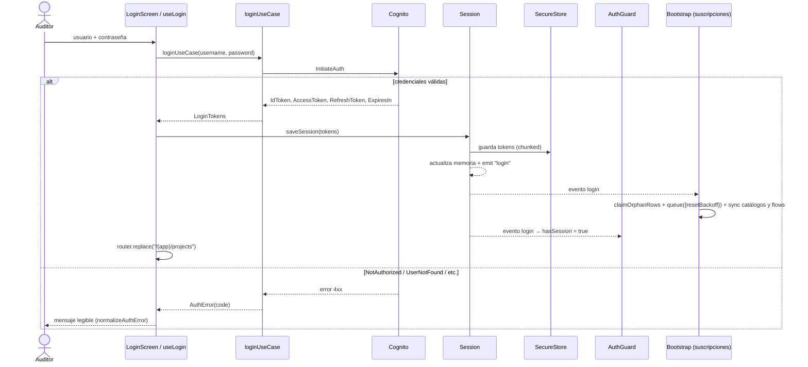
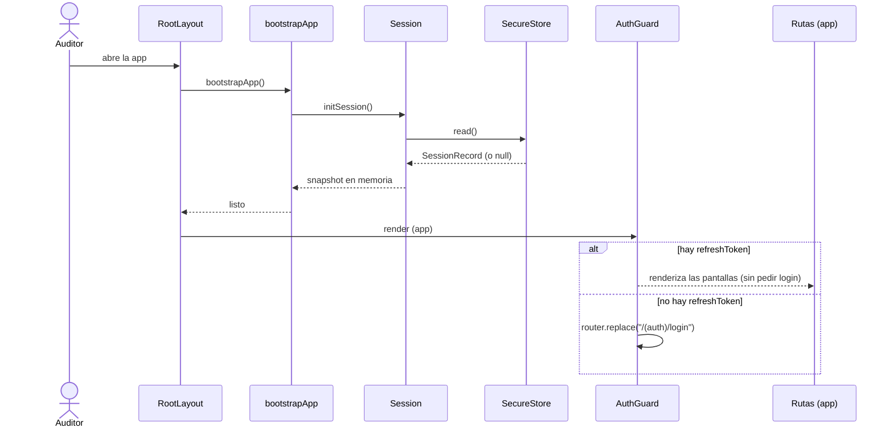
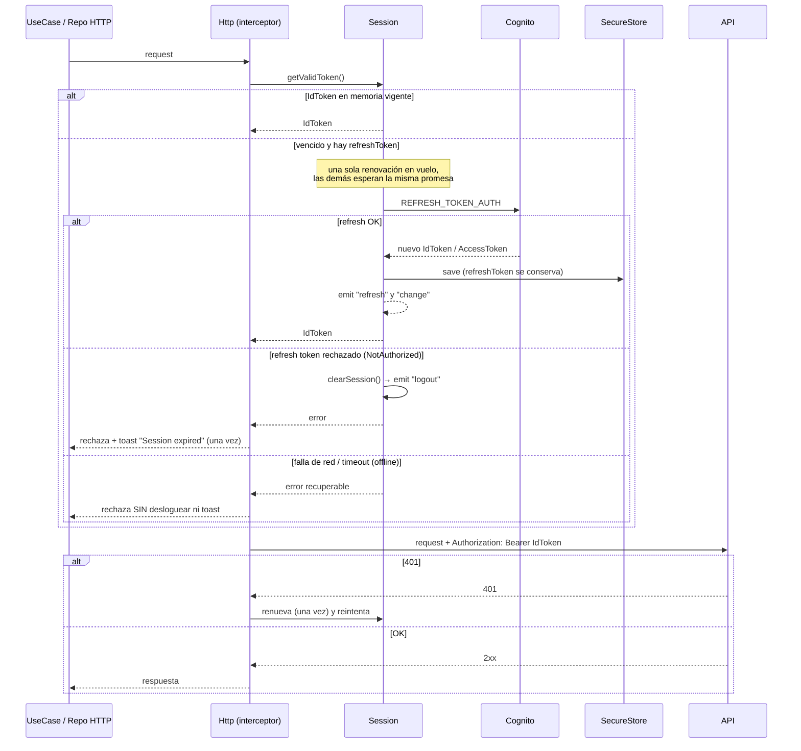
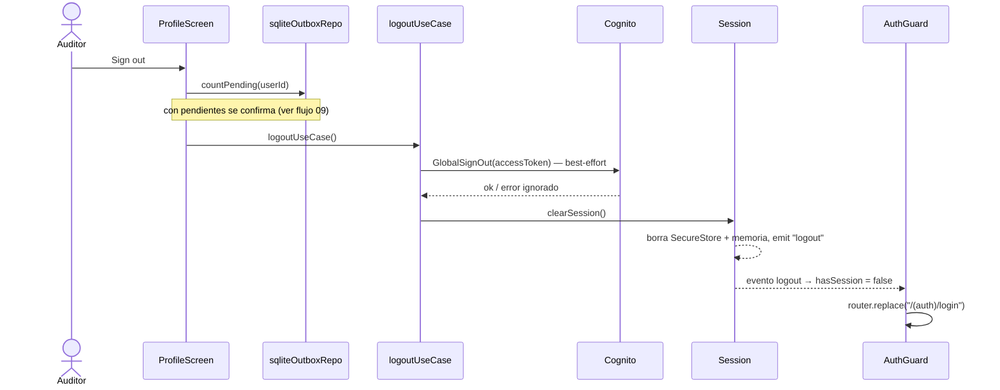

# 01 — Login, sesión y refresh de token

Participantes: Auditor, LoginScreen/`useLogin`, `loginUseCase`, Cognito, Session, SecureStore, AuthGuard, Http.

## 1.1 Login (online)

El login requiere red. Sin conexión la pantalla muestra el error de red y no se crea sesión.

## 1.2 Reapertura de la app con sesión persistida (online u offline)

No hace falta red para entrar: el IdToken vencido se renueva recién cuando hay una request que lo necesita.

## 1.3 Request con token vencido (refresh single-flight)

Offline: el fallo de refresh por red no cierra la sesión; el outbox reintenta cuando vuelva la conexión.

## 1.4 Logout

Si no hay red, el `GlobalSignOut` falla y se ignora: la sesión local igual se limpia.
