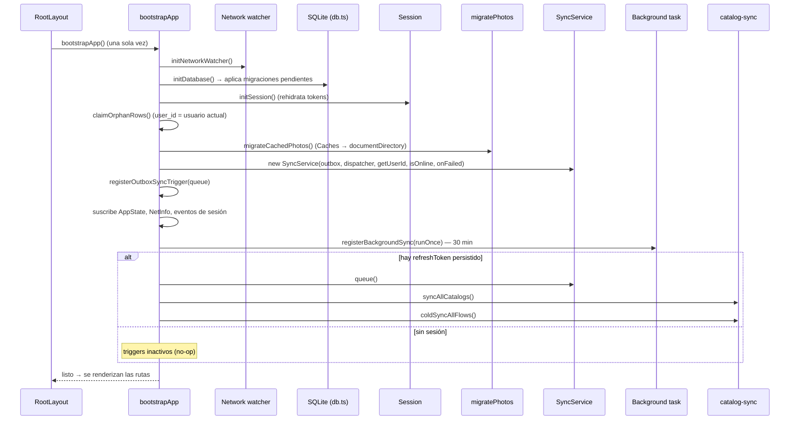
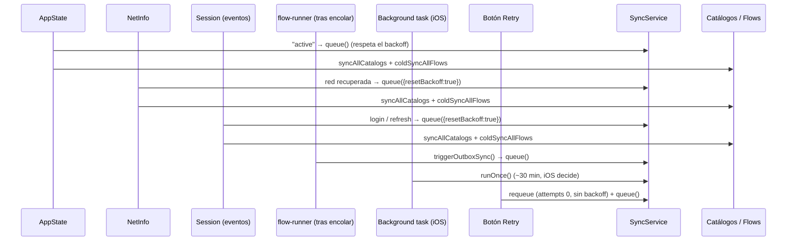

# 02 — Bootstrap y disparadores de sincronización

## 2.1 Arranque (`bootstrapApp`)

Funciona igual offline: la app abre con los datos locales; los triggers de red lo recuperan después.

## 2.2 Disparadores durante el uso

Todos los triggers son **no-op sin refresh token**. `queue()` coalesce: si ya hay una corrida, marca que debe
repetirse al terminar. `syncAllCatalogs` tiene cooldown de 60 s y `coldSyncAllFlows` comparte una promesa en vuelo.
El foreground no resetea el backoff para no consumir intentos en cada apertura de la app.
