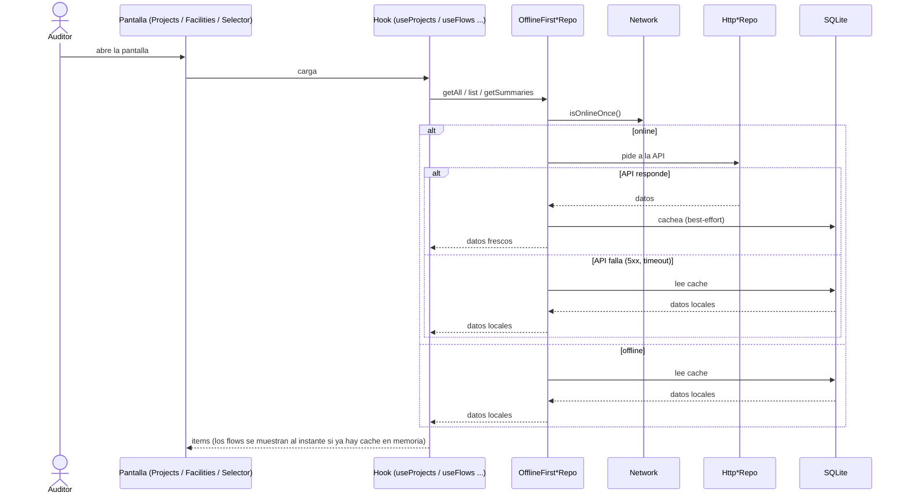

# 03 — Sync de catálogos y lectura offline-first

Catálogos: **proyectos**, **facilities** y **flows** (con sus steps e imágenes). Se sincronizan en segundo plano y
las pantallas leen siempre con el patrón offline-first.

## 3.1 Sync completo (online)

```mermaid
sequenceDiagram
  participant T as Trigger (boot / foreground / red / login)
  participant CS as syncAllCatalogs
  participant PR as HttpProjectRepo
  participant FR as HttpFlowRepo
  participant API as API
  participant DB as SQLite
  participant IC as imageCache
  participant FS as File system

  T->>CS: syncAllCatalogs()
  alt hay sync en curso
    CS-->>T: devuelve la misma promesa
  else corrió hace < 60 s
    CS-->>T: sale sin hacer nada (cooldown)
  else offline
    CS-->>T: sale sin hacer nada
  end

  Note over CS,PR: 1) Proyectos
  loop hasta que no haya nextCursor
    CS->>PR: list({cursor})
    PR->>API: GET /projects
    API-->>PR: página
  end
  CS->>DB: sqliteProjectRepo.replaceAll(all)
  CS->>DB: sqliteFacilityRepo.upsertMany(facilities embebidas)

  Note over CS,FR: 2) Flows
  CS->>FR: fetchCatalog() (via OfflineFirstFlowRepo)
  FR->>API: GET /flows
  API-->>FR: { flows: [...] }
  FR->>FR: valida cada flow por separado (safeParse)
  FR-->>CS: flows válidos + descartados
  CS->>DB: saveCatalog (prune, salvo descartados)
  CS->>DB: saveFlowDetail solo de los flows que cambiaron
  CS->>IC: precache de imágenes (concurrencia 4)
  IC->>API: descarga imágenes
  IC->>FS: documentDirectory/flow-images/

  Note over CS,API: 3) Facilities por proyecto
  loop cada proyecto cacheado
    CS->>API: GET facilities del proyecto (paginado)
    CS->>DB: replaceAllForProject
  end
```

Detalles:

- Un flow con un `type` de paso o campo desconocido se **descarta y se loguea**; los demás se actualizan y el
  inválido conserva su última versión cacheada (no entra en el prune).
- Un flow no se reescribe en SQLite si `version`, `updatedAt` y cantidad de steps no cambiaron y sus steps ya están
  guardados.
- Si falla un paso (red, 5xx) se loguea y se sigue con el siguiente: nunca rompe la app.

## 3.2 Lectura desde una pantalla (online vs. offline)

Offline la pantalla funciona igual con lo último que se sincronizó; las imágenes de los steps salen de
`flow-images/`.
