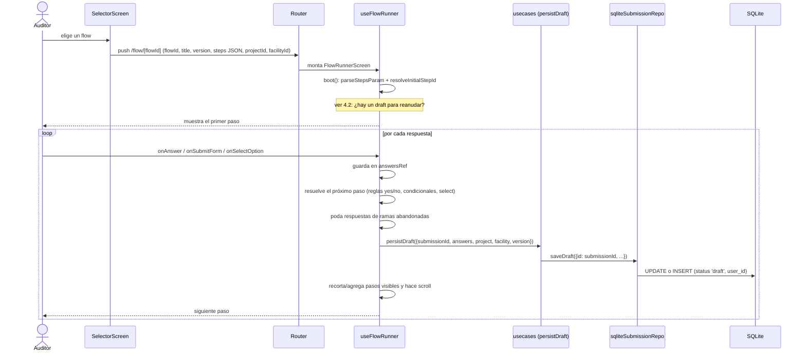
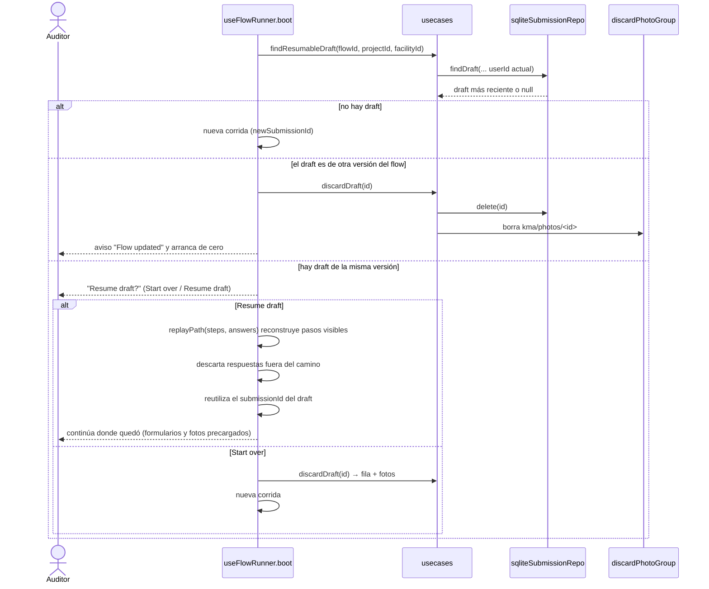

# 04 — Ejecución de un flow, draft y reanudación

El draft se guarda **siempre en SQLite**, con o sin red. Una auditoría = una fila de `submissions`
(id estable por corrida).

## 4.1 Iniciar un flow y responder pasos

Todo esto ocurre localmente: el flow viene por parámetros de navegación (cargado de la cache) y el draft va a
SQLite, por lo que **no necesita red**.

## 4.2 Reanudar o empezar de nuevo

Salir de la pantalla y volver no reinicia la corrida (el `boot` solo corre al montar o cuando cambian los params).
Si el auditor sale sin terminar, el draft queda disponible para la próxima vez.
