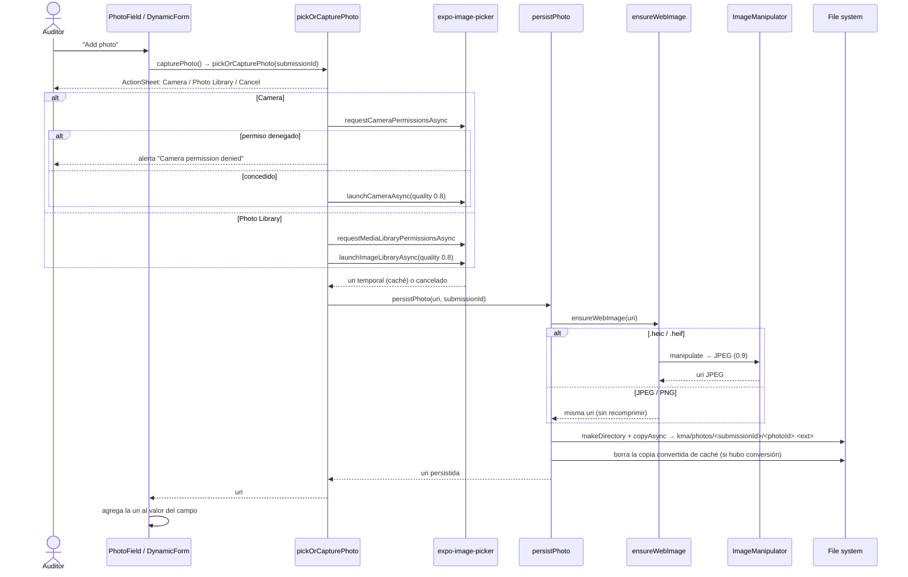
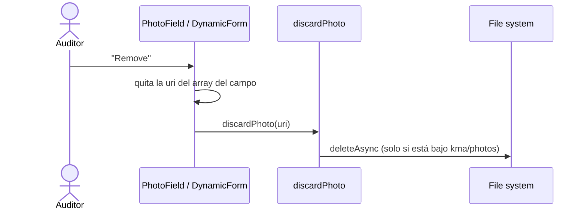
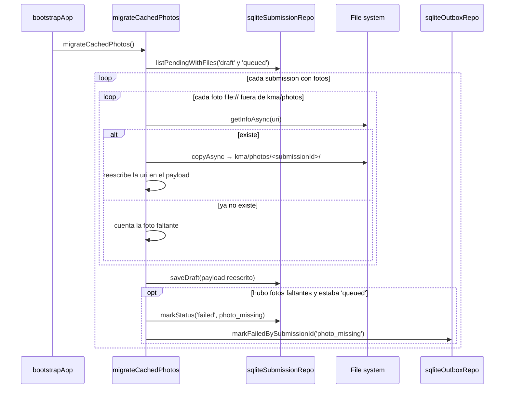

# 05 — Captura y persistencia de fotos

Las fotos se copian a `documentDirectory/kma/photos/<submissionId>/` apenas se toman, porque `Library/Caches` puede
ser purgada por iOS con poco espacio. No requiere red.

## 5.1 Tomar o elegir una foto

## 5.2 Quitar una foto

## 5.3 Fotos guardadas en caché por versiones anteriores (migración en el arranque)

La migración es idempotente: las URIs ya persistidas se saltean.
