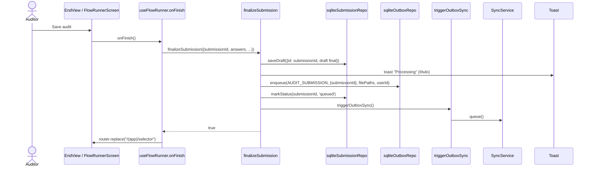
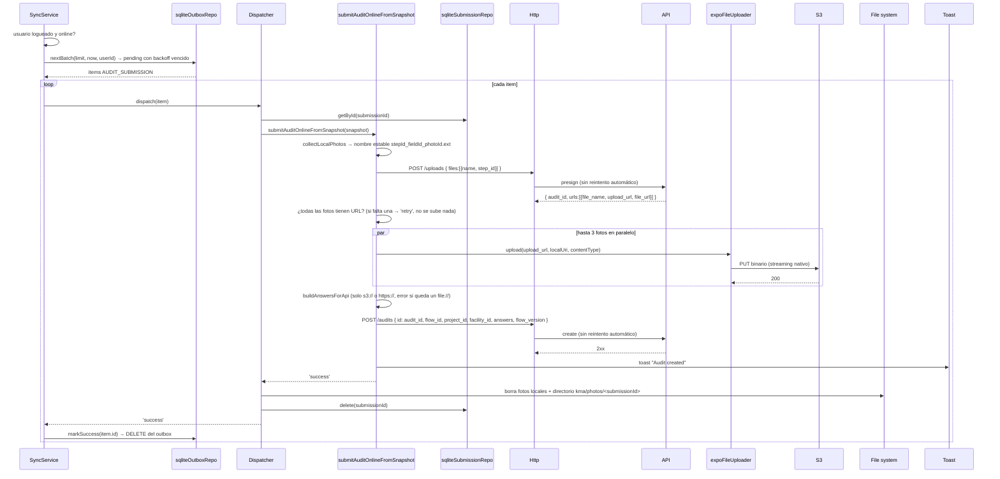

# 06 — Finalizar y enviar una auditoría (online)

El envío **siempre** pasa por el outbox, haya red o no. El auditor termina el flow, la auditoría queda encolada y el
`SyncService` la envía enseguida si hay conexión. Variante sin red: [07](./07-envio-offline-y-reconexion.md).

## 6.1 Finalizar: guardar y encolar

## 6.2 Envío (SyncService → API → S3)

Puntos clave:

- El `POST /uploads` y el `POST /audits` **no** se reintentan en el interceptor: si hay un timeout, el outbox
  reentrega; así no se crean dos auditorías por un reintento a ciegas.
- Una auditoría **nunca** se envía incompleta: si falta la URL de una foto o queda una foto local sin subir, el
  resultado es `retry`.
- La limpieza local ocurre solo después del 2xx del `POST /audits`.
- Los errores y reintentos están en [08](./08-reintentos-fallos-y-retry.md).
