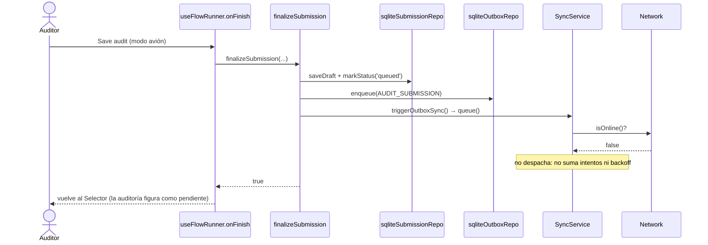
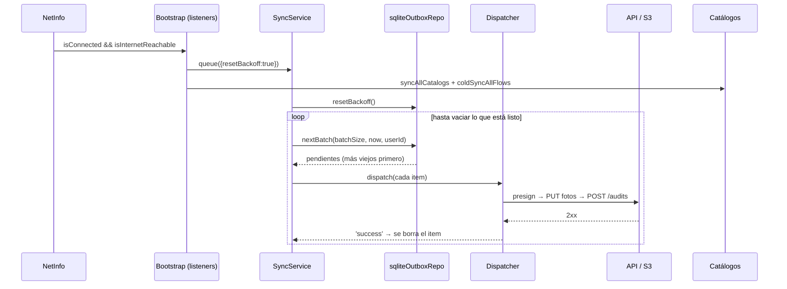
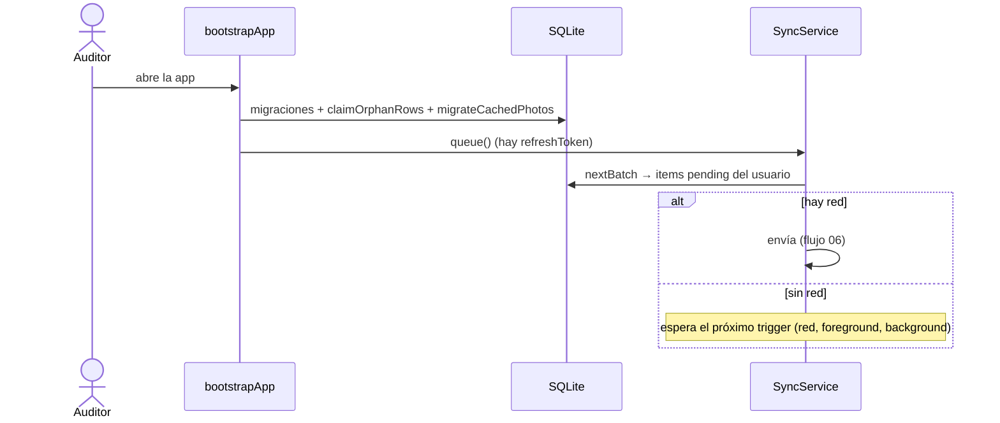

# 07 — Auditoría terminada sin red y envío al reconectar

Completar y terminar una auditoría **no requiere conexión**: todo queda en SQLite y en `documentDirectory`.

## 7.1 Finalizar sin red

## 7.2 Reconexión

Orden y garantías:

- Se procesan en orden de creación (`created_at ASC`).
- Con más de `SYNC_BATCH_SIZE` pendientes, la corrida sigue con lotes hasta vaciar la cola (no espera otro trigger).
- Si la app se cierra antes de reconectar, no se pierde nada: al reabrirla el bootstrap dispara `queue()` y el
  estado (`attempts`, `next_attempt_at`) sigue en SQLite.
- Si la app está en segundo plano, la tarea de background (~30 min, a criterio de iOS) puede hacer `runOnce()`.

## 7.3 Reapertura con auditorías pendientes

