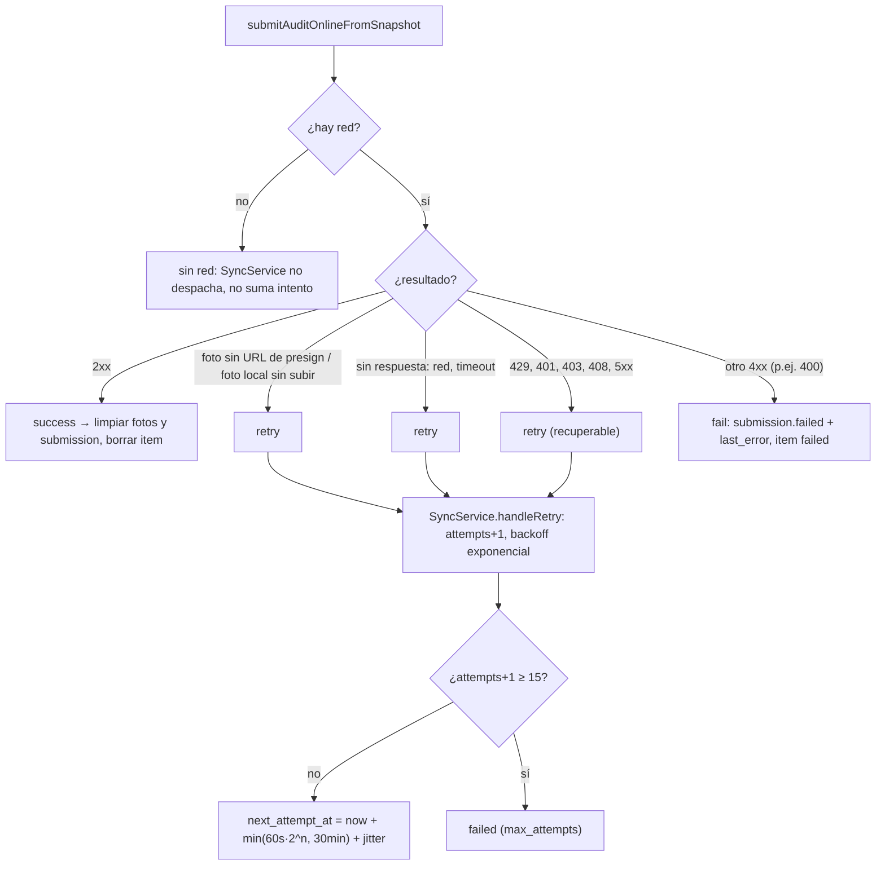
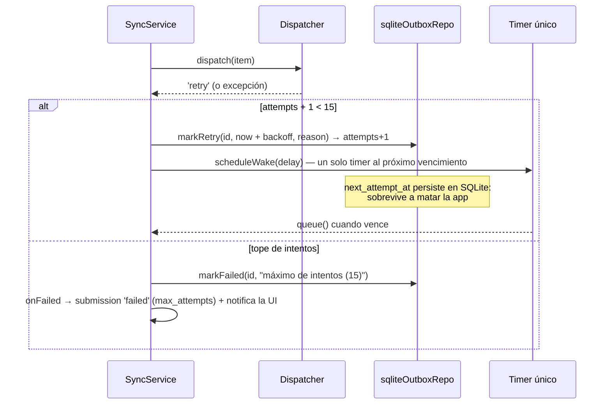
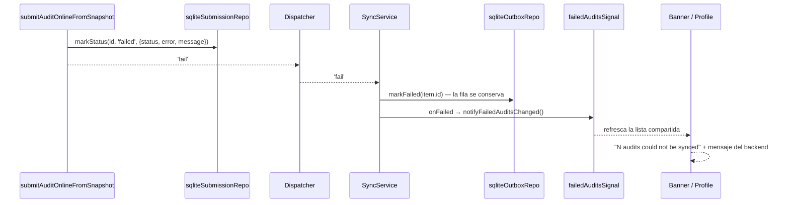
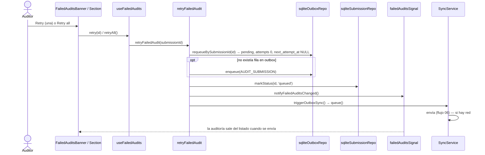

# 08 — Reintentos, auditorías fallidas y Retry manual

Regla central: **una auditoría nunca se borra por un error**. Se reintenta con backoff o queda `failed`, visible y
reintentable.

## 8.1 Clasificación del resultado de un envío

El `S3 403` (URL presignada vencida) llega como `UploadError(403)`: se trata como recuperable y el reintento
vuelve a pedir el presign.

## 8.2 Reintento automático con backoff

Un item en backoff **no ocupa lugar en el lote**: una auditoría nueva se envía igual aunque haya otras fallando.

## 8.3 Fallo definitivo (4xx no recuperable)

`message` sale del formato de error del backend (`{ error, message, code }`); si no lo respeta, se guarda
`HTTP <status>` + el body recortado.

## 8.4 Retry manual

Banner (Selector) y sección (Profile) comparten un mismo store: una sola consulta aunque ambos estén montados.
Sin auditorías fallidas la UI no muestra nada.
