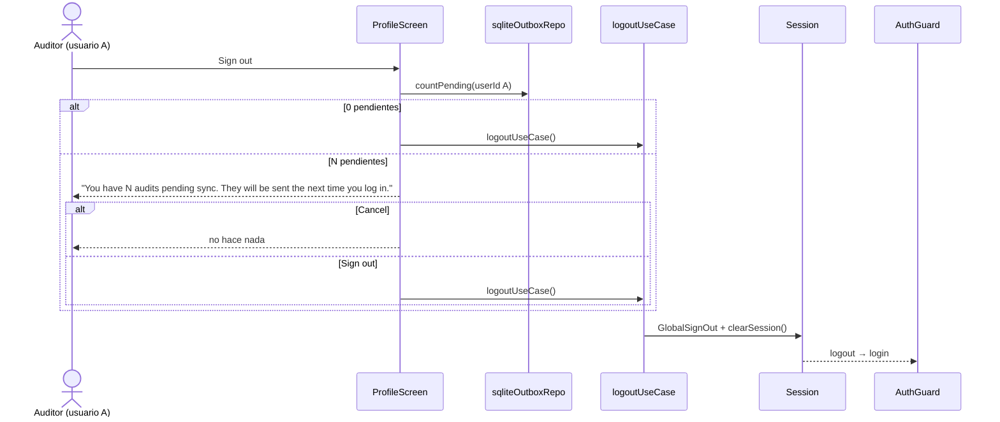
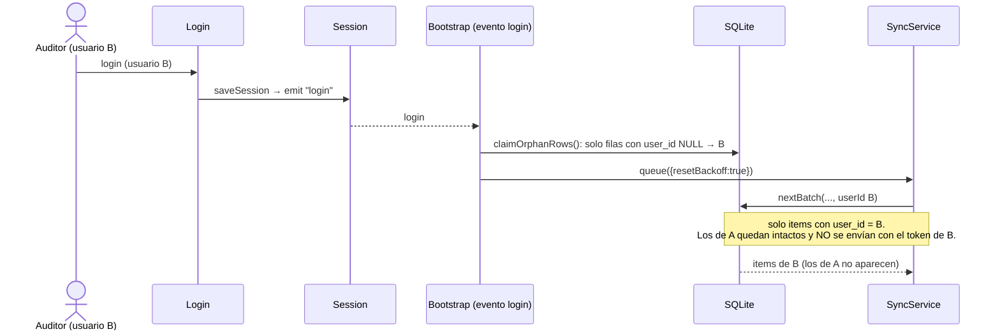
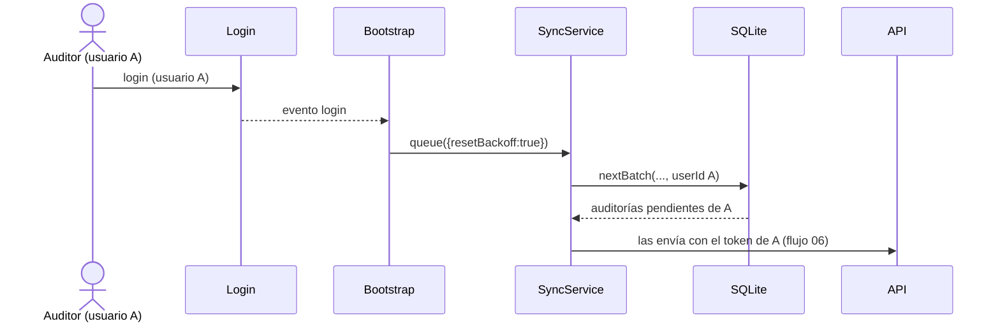

# 09 — Pendientes por usuario y logout

Las submissions y los items de outbox llevan `user_id` (el `sub` del IdToken). El outbox solo se drena con el
token de su dueño.

## 9.1 Logout con auditorías pendientes

Los datos locales **no se borran** al cerrar sesión: drafts, auditorías encoladas y fotos quedan en el dispositivo.

## 9.2 Otro usuario inicia sesión en el mismo dispositivo

También quedan filtrados por usuario: la búsqueda de drafts para reanudar y la lista de auditorías fallidas.

## 9.3 Vuelve el usuario original

## 9.4 Sin sesión

Sin `refreshToken` persistido, los triggers del bootstrap son no-op. Con refresh token pero sin `sub`
decodificable, `SyncService` no drena (`getUserId() = null`). Los items esperan hasta que haya un usuario válido.

## 9.5 Filas sin dueño

Las filas creadas por versiones anteriores de la app no tienen `user_id` (`NULL`). En el primer arranque con sesión
(y en cada login) se asignan al usuario actual, asumiendo un solo auditor por dispositivo en esos datos.
